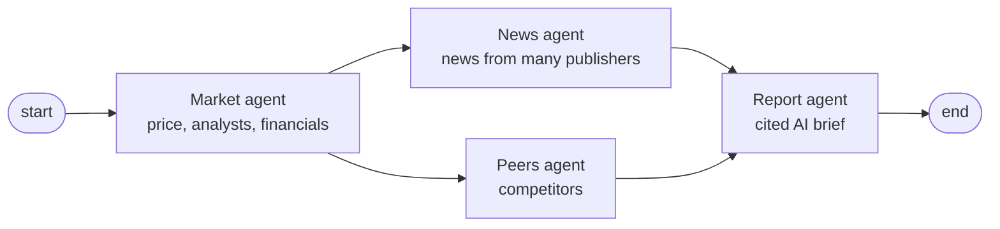

# AlphaSignal

Enter a company or ticker and get everything that matters in one page: live price, analyst consensus, financial health, a comparison with competitors, recent news from many publishers, and an AI-written brief where every claim links to its source. Written to be readable by beginner investors.

## Features

- **Search by company name or ticker** with autocomplete
- **Price chart** (1M / 6M / 1Y / 5Y) with the average analyst target
- **Key numbers with context**, e.g. "near its 1-year high", "cheaper than its competitors", plus plain-English ⓘ explanations
- **Financial health**: sales growth, profit margin, cash vs. debt, free cash flow, dividend, volatility
- **Earnings vs. expectations** for the last four quarters
- **Competitor comparison** (Finnhub peers, AI fallback)
- **AI brief**: what happened, bull and bear case, what to watch, and news sentiment, each point cited
- **News** from Google News, Seeking Alpha, Nasdaq and Yahoo Finance, filtered for relevance and capped per publisher
- Live progress while the agents work, 15-minute caching, and shareable links (`?t=NVDA`)
- **My portfolio**: save your holdings (shares and purchase price) in PostgreSQL and see value, gain/loss, today's move and weights in EUR

## How it works

The analysis is a [LangGraph](https://langchain-ai.github.io/langgraph/) graph of four agents. LangGraph orchestrates in the backend; each agent runs in its own Docker container and receives work over a Redis queue (Celery):



1. **Market agent** fetches price, analyst data, financials, earnings history and insider trades (yfinance). It runs first because the others need the company name.
2. **News agent** and **Peers agent** run in parallel: news from Google News (also in the stock's home-market language), Yahoo Finance, Seeking Alpha and Nasdaq; competitors from Finnhub, reviewed by AI.
3. **Report agent** waits for both, then writes a structured brief with an OpenAI model, citing articles by ID.

Each agent can be scaled separately, e.g. `docker compose up -d --scale news-agent=4`. If a worker dies mid-job, the job times out and LangGraph retries it on another worker (up to 3 attempts with backoff). An unknown ticker fails immediately. Progress, including which worker ran each agent, is streamed to the React frontend with Server-Sent Events. To print the graph: `python pipeline.py --graph`.

The portfolio and morning-email settings are stored in PostgreSQL (run with Docker Compose) through SQLAlchemy, with Alembic migrations applied on startup.

## Running locally

**Database, queue and agents** (Docker, e.g. Rancher Desktop or Docker Desktop). First create `backend/.env` from `backend/.env.example` and add your API keys.

```bash
docker compose up -d --build
```

**Backend** (Python 3.9+)

```bash
cd backend
python3 -m venv venv
source venv/bin/activate
pip install -r requirements.txt
cp .env.example .env   # then add your API keys
uvicorn main:app --reload
```

**Frontend**

```bash
cd frontend
npm install
npm start
```

Open http://localhost:3000.

## Disclaimer

AlphaSignal summarises public news and market data with AI. It can contain errors and is not financial advice. Market data comes from yfinance, an unofficial Yahoo Finance library intended for personal and educational use.
